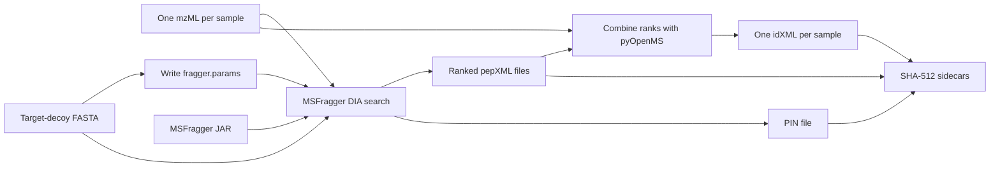

# pipeline-search-ProteomicDIA

[](https://github.com/TheBoutrosLab/pipeline-search-ProteomicDIA/actions/workflows/prepare-release.yaml)

- [Overview](#overview)
- [How To Run](#how-to-run)
- [Pipeline Steps](#pipeline-steps)
- [Inputs](#inputs)
  - [Input CSV](#input-csv)
  - [Config](#config)
- [Outputs](#outputs)
- [Resources](#resources)
- [Testing and Validation](#testing-and-validation)
- [References](#references)
- [Discussions](#discussions)
- [Contributors](#contributors)
- [License](#license)

## Overview

This Nextflow DSL2 pipeline searches unfractionated DIA mzML files against a supplied target-decoy protein FASTA with MSFragger. It writes a native MSFragger parameter file, searches each sample independently, and combines that sample's ranked pepXML results into one idXML with pyOpenMS. Unfiltered pepXML, PIN, and idXML results are retained with SHA-512 checksums for downstream validation and analysis. This version does not perform FDR estimation, PSM filtering, or quantification.

## How To Run

1. Initialize the repository's Git submodules with `git submodule update --init --recursive`. Copy [config/template.config](config/template.config) to a run-specific config file and set `dataset_id`, `input_csv`, `output_dir`, `decoy_database`, `decoy_prefix`, and `msfragger_executable`. Review the `MSFragger` search settings for the data and FASTA.

2. Create an input CSV using [input/input.csv](input/input.csv). List one unfractionated mzML file per sample.

3. Obtain the MSFragger JAR separately under its license, then run the pipeline:

   ```bash
   export NXF_VER=24.10.6
   export NXF_SYNTAX_PARSER=v1
   nextflow run . -c my-run.config
   ```

   The template uses Docker by default. Select `-profile apptainer` or `-profile singularity` where appropriate. The [`.env-template`](.env-template) records the Nextflow version and parser used by the shared pipeline configuration.

## Pipeline Steps



`write_MSFraggerParams` creates a native `fragger.params` file from `params.MSFragger` and the decoy prefix. `search_database_MSFragger` runs the supplied JAR on each mzML with the target-decoy FASTA, producing a PIN file and one or more pepXML files (including `_rankN.pepXML` files in DIA mode). `convert_pepXML2idXML_MSFragger` uses [PepXMLs2IdXML.py](src/PepXMLs2IdXML.py) and pyOpenMS 3.5.0 to combine the pepXML ranks for each sample. The idXML records the source mzML as `file_origin` and retains the MSFragger rank and source pepXML filename as separate metadata.

`calculate_SHA512` writes a checksum sidecar for every pepXML rank, PIN file, and idXML file.

## Inputs

### Input CSV

The CSV must have exactly these columns, with one unfractionated mzML per row:

| Field | Required | Description |
| ----- | -------- | ----------- |
| `sample_name` | yes | Unique name used for the sample's idXML output. Use letters, digits, `.`, `_`, or `-`, starting with a letter or digit. |
| `mzML` | yes | Path to the sample's mzML. Relative paths resolve from the CSV directory. Each mzML and mzML basename may appear only once. |

```csv
sample_name,mzML
sample_01,/data/sample_01.mzML
sample_02,/data/sample_02.mzML
```

The protein FASTA must already contain target and decoy entries. Set `decoy_prefix` to match the FASTA's decoy identifiers; the pipeline does not generate decoys.

### Config

| Parameter | Type | Description |
| --------- | ---- | ----------- |
| `dataset_id` | string | Identifier for the output subdirectory. |
| `input_csv` | path | CSV with `sample_name,mzML` columns. |
| `output_dir` | path | Root output directory. |
| `decoy_database` | path | Target-decoy protein FASTA. |
| `decoy_prefix` | string | Prefix of decoy FASTA entries; defaults to `rev_`. |
| `msfragger_executable` | path | Separately obtained MSFragger JAR. |
| `MSFragger` | namespace | Native MSFragger parameter names. Commonly changed values are in [config/template.config](config/template.config); other defaults are in [config/default.config](config/default.config). DIA mode and pepXML/PIN output are fixed for this version. |
| `save_intermediate_files` | boolean | Publish the generated `fragger.params`; defaults to `false`. |
| `work_dir` | path | Optional Nextflow work directory; otherwise uses `NXF_WORK` or `work` under the launch directory. Use a distinct directory for concurrent runs to avoid work-file collisions. |
| `base_resource_update` | namespace | Optional per-process CPU and memory multipliers. |

The full MSFragger parameter list and validation rules are in [config/schema.yaml](config/schema.yaml).

## Outputs

Results are written under `<output_dir>/search-ProteomicDIA-0.1.0/<dataset_id>/`:

| Output | Description |
| ------ | ----------- |
| `output/MSFragger/<mzML basename>*.pepXML` | Unfiltered MSFragger pepXML output, including all reported rank files. |
| `output/MSFragger/<mzML basename>.pin` | Unfiltered MSFragger PIN file. |
| `output/MSFragger/<sample_name>_MSFragger.idXML` | One idXML containing the sample's pepXML ranks. |
| `output/MSFragger/<result filename>.sha512` | SHA-512 checksum for each pepXML, PIN, and idXML file; compatible with `sha512sum -c`. |
| `intermediate/MSFragger/fragger.params` | Generated search parameters, published only when `save_intermediate_files = true`. |
| `log-search-ProteomicDIA-0.1.0-<timestamp>/` | Nextflow reports, trace, configuration, and process logs. |

## Resources

[config/resources.json](config/resources.json) defines one allocation profile for all node types. The initial per-task allocations are:

| Process | CPUs | Memory |
| ------- | ---- | ------ |
| `write_MSFraggerParams` | 1 | 1 GB |
| `search_database_MSFragger` | 12 | 64 GB |
| `convert_pepXML2idXML_MSFragger` | 2 | 24 GB |
| `calculate_SHA512` | 1 | 1 GB |

The shared resource handler caps requests at available resources. Search and conversion can retry once with twice the memory after a retryable failure, subject to that cap. Use `base_resource_update` to adjust allocations for a particular run.

## Testing and Validation

The [UCLA NFTest integration case](test/README.md) searches unfractionated *E. coli* DIA mzML fixture data with a target-decoy FASTA and a separately supplied MSFragger JAR. Set `TEST_DATA_DIR` in a local `.env` file based on [`.env-template`](.env-template), then run `bash test/run-nftest.sh test-integration-msfragger` in the supported cluster environment. The runner retains output and work files under `/scratch` for inspection. Scientific validation metrics have not yet been established for version 0.1.0.

## References

1. Yu et al. Analysis of DIA proteomics data using MSFragger-DIA and FragPipe computational platform. *Nature Communications*, 14, 4154 (2023). [doi:10.1038/s41467-023-39869-5](https://doi.org/10.1038/s41467-023-39869-5)
2. Pfeuffer et al. OpenMS 3 enables reproducible analysis of large-scale mass spectrometry data. *Nature Methods*, 21, 365–367 (2024). [doi:10.1038/s41592-024-02197-7](https://doi.org/10.1038/s41592-024-02197-7)
3. [MSFragger documentation](https://github.com/Nesvilab/MSFragger) and [pyOpenMS documentation](https://pyopenms.readthedocs.io/en/release-3.5.0/).

## Discussions

- [Issue tracker](https://github.com/TheBoutrosLab/pipeline-search-ProteomicDIA/issues) for errors and enhancement ideas.
- [Discussions](https://github.com/TheBoutrosLab/pipeline-search-ProteomicDIA/discussions) and [pull requests](https://github.com/TheBoutrosLab/pipeline-search-ProteomicDIA/pulls) for pipeline development.

## Contributors

See the [GitHub contributors](https://github.com/TheBoutrosLab/pipeline-search-ProteomicDIA/graphs/contributors).

## License

pipeline-search-ProteomicDIA is licensed under the GNU General Public License version 2. See [LICENSE](LICENSE) for the terms.

Search unfractionated DIA mzML files against a target-decoy protein database with MSFragger.

Copyright (C) 2026 Sanford Burnham Prebys Medical Discovery Institute ("Boutros Lab")

This program is free software; you can redistribute it and/or modify it under the terms of the GNU General Public License as published by the Free Software Foundation; either version 2 of the License, or (at your option) any later version.

This program is distributed in the hope that it will be useful, but WITHOUT ANY WARRANTY; without even the implied warranty of MERCHANTABILITY or FITNESS FOR A PARTICULAR PURPOSE. See the GNU General Public License for more details.
